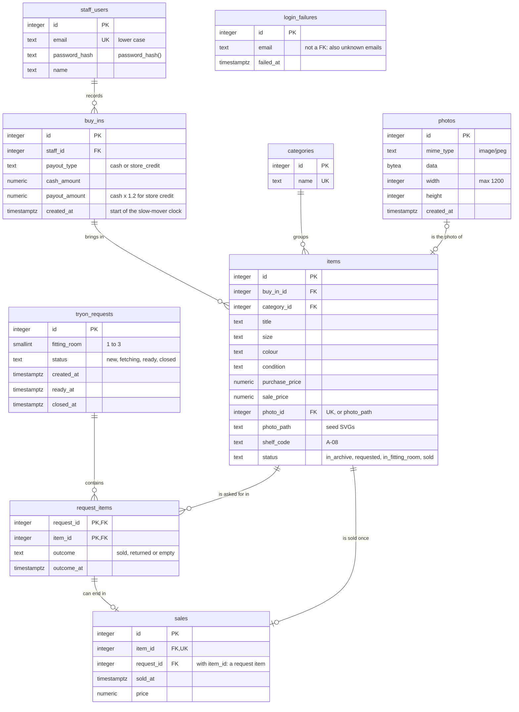

# Backroom: data tables

The database of the Backroom MVP (PostgreSQL 17). This document follows [`sql/schema.sql`](../sql/schema.sql), which is the source of truth.
- **Money:** `NUMERIC(8,2)` in euros.
- **Times:** `TIMESTAMPTZ` (an exact moment). "Today" and "this week" are worked out in Porto time by the app.
- **Ids:** every table except `request_items` has a whole-number `id` that the database counts up by itself (`INTEGER GENERATED BY DEFAULT AS IDENTITY`).

## Overview

**Reading the diagram:**
- `||` means exactly one, `o|` zero or one, `o{` zero or more.
- `login_failures` has no relationship on purpose: it also counts failed logins for emails that don't exist.
- A sale points to its item, and through `(request_id, item_id)` to the exact item in the request it was sold from.

**Two rules the app checks, which the database can't enforce:**
- a buy-in has at least 1 and at most 10 items, and its `cash_amount` is the sum of their purchase prices (`src/Intake.php`)
- a try-on request has 1 to 5 items (`src/Requests.php`).

**Abbreviations:** PK = primary key, FK = foreign key, UK = unique. "–" means no extra rule.

---

## staff_users

Everyone who can log in to the staff and manager screens. One role in the MVP, so every staff member can also see the dashboard.

| Column | Type | Key | Main constraints |
|---|---|---|---|
| `id` | `INTEGER` (identity) | PK | – |
| `email` | `TEXT` | UK | Required; unique; must be lower case and contain `@` (not as the first character). |
| `password_hash` | `TEXT` | – | Required. A `password_hash()` hash, checked with `password_verify()`; the password itself is never stored. |
| `name` | `TEXT` | – | Required; not empty or only spaces. Shown in the staff header. |

## login_failures

Failed login attempts per email, for the guessing limit (after 5 failures, that email waits 1 minute). Kept in the database so clearing cookies doesn't reset the count.

| Column | Type | Key | Main constraints |
|---|---|---|---|
| `id` | `INTEGER` (identity) | PK | – |
| `email` | `TEXT` | – | Required; lower case. **Not** a foreign key: unknown emails are counted too, so the app doesn't reveal which emails exist. |
| `failed_at` | `TIMESTAMPTZ` | – | Required; default `now()`. |

Index: `(email, failed_at)`, to count recent failures per email quickly. Rows older than a day are deleted by the app.

## categories

The clothing categories customers filter on (Tops, Knitwear, Trousers, Dresses, Jackets & coats in the demo data).

| Column | Type | Key | Main constraints |
|---|---|---|---|
| `id` | `INTEGER` (identity) | PK | – |
| `name` | `TEXT` | UK | Required; unique; not empty or only spaces. |

## buy_ins

One visit from a walk-in seller: who registered it, how the seller is paid, and when. The date is also where the slow-mover clock of its items starts.

| Column | Type | Key | Main constraints |
|---|---|---|---|
| `id` | `INTEGER` (identity) | PK | – |
| `staff_id` | `INTEGER` | FK → `staff_users.id` | Required. The logged-in staff member who saved it. |
| `payout_type` | `TEXT` | – | Required; `cash` or `store_credit`. |
| `cash_amount` | `NUMERIC(8,2)` | – | Required; ≥ 0. The sum of the items' purchase prices (checked by the app). |
| `payout_amount` | `NUMERIC(8,2)` | – | Required. See the payout rule below. |
| `created_at` | `TIMESTAMPTZ` | – | Required; default `now()`. |

Table rule `buy_ins_payout_matches_type`: for `cash`, `payout_amount = cash_amount`; for `store_credit`, `payout_amount = round(cash_amount × 1.2, 2)`. So a wrong payout can never be saved.

## photos

Uploaded item photos, stored in the database because Render's free plan loses uploaded files on every restart. Always a JPEG of at most 1200px wide, served by `public/photo.php?id=`.

| Column | Type | Key | Main constraints |
|---|---|---|---|
| `id` | `INTEGER` (identity) | PK | – |
| `mime_type` | `TEXT` | – | Required; must be `image/jpeg` (every upload is converted to JPEG). |
| `data` | `BYTEA` | – | Required; not empty. The image itself. |
| `width` | `INTEGER` | – | Required; 1 to 1200. |
| `height` | `INTEGER` | – | Required; > 0. |
| `created_at` | `TIMESTAMPTZ` | – | Required; default `now()`. |

A photo no item points to is "pending": it's kept while a buy-in form has errors, so the photo doesn't have to be uploaded again. The app deletes pending photos older than a day.

## items

Every piece of clothing in the shop, with its details for the customer, its prices, its shelf in the back room and its status.

| Column | Type | Key | Main constraints |
|---|---|---|---|
| `id` | `INTEGER` (identity) | PK | – |
| `buy_in_id` | `INTEGER` | FK → `buy_ins.id` | Required. The buy-in it came from. |
| `category_id` | `INTEGER` | FK → `categories.id` | Required. |
| `title` | `TEXT` | – | Required; not empty or only spaces. |
| `size` | `TEXT` | – | Required; one of `XS`, `S`, `M`, `L`, `XL`, `XXL`. |
| `colour` | `TEXT` | – | Required; one of `black`, `white`, `grey`, `navy`, `blue`, `green`, `red`, `pink`, `beige`, `brown`. |
| `condition` | `TEXT` | – | Required; `like_new`, `good` or `fair`. |
| `purchase_price` | `NUMERIC(8,2)` | – | Required; ≥ 0. What the shop paid. |
| `sale_price` | `NUMERIC(8,2)` | – | Required; > 0, and not lower than the purchase price. |
| `photo_id` | `INTEGER` | FK → `photos.id`, UK | Optional; unique (one photo belongs to one item). An uploaded photo. |
| `photo_path` | `TEXT` | – | Optional; not empty if set. A static file, used by the seed data's placeholder SVGs. |
| `shelf_code` | `TEXT` | – | Required; format `A-08`: one capital letter (the rack), a dash, two digits (the spot). |
| `status` | `TEXT` | – | Required; default `in_archive`. One of `in_archive`, `requested`, `in_fitting_room`, `sold`. |

Table rules:
- `items_sale_not_below_purchase`: `sale_price ≥ purchase_price`.
- `items_one_photo`: exactly one of `photo_id` and `photo_path` is set, so an item always has a photo, never two.

Unique rule `items_shelf_code_unsold`: a shelf code is unique among **unsold** items (`WHERE status <> 'sold'`). One spot holds one item, and selling an item frees its spot for a new one.

Other indexes: `status` (the archive shows only `in_archive`) and `buy_in_id`.

Status flow: `in_archive` → `requested` → `in_fitting_room` → `sold`, or back to `in_archive`. Each step is one function in `src/` that checks the current status inside a transaction.

## tryon_requests

A customer's request to try items on: which fitting room, and how far staff have got with it.

| Column | Type | Key | Main constraints |
|---|---|---|---|
| `id` | `INTEGER` (identity) | PK | – |
| `fitting_room` | `SMALLINT` | – | Required; 1 to 3. |
| `status` | `TEXT` | – | Required; default `new`. One of `new`, `fetching`, `ready`, `closed`. |
| `created_at` | `TIMESTAMPTZ` | – | Required; default `now()`. When the customer sent it. |
| `ready_at` | `TIMESTAMPTZ` | – | Set when the items reach the fitting room. |
| `closed_at` | `TIMESTAMPTZ` | – | Set when every item has an outcome. |

Table rules:
- `tryon_ready_at_matches_status`: `ready_at` is set exactly when the status is `ready` or `closed`.
- `tryon_closed_at_matches_status`: `closed_at` is set exactly when the status is `closed`.
- `tryon_times_in_order`: `ready_at ≥ created_at` and `closed_at ≥ ready_at`.

Index: `(status, created_at)`, for the fetch queue (open requests, oldest first).

## request_items

Which items are in which request, and what happened to each one in the fitting room.

| Column | Type | Key | Main constraints |
|---|---|---|---|
| `request_id` | `INTEGER` | PK (with `item_id`), FK → `tryon_requests.id` | Required. |
| `item_id` | `INTEGER` | PK (with `request_id`), FK → `items.id` | Required. |
| `outcome` | `TEXT` | – | Empty until staff decide; then `sold` or `returned` ("Back to archive"). |
| `outcome_at` | `TIMESTAMPTZ` | – | When "Sold" or "Back to archive" was pressed. |

Primary key `(request_id, item_id)`: an item is in a request at most once.

Table rule `request_items_outcome_at_matches`: `outcome` and `outcome_at` are either both set or both empty.

Index: `item_id`. An item can be in several requests over time, for example requested, returned, and requested again later.

## sales

One row per item sold from a fitting room, with the price and the moment of the sale. It's the basis for "Sold", "Revenue" and "Gross margin" on the dashboard.

| Column | Type | Key | Main constraints |
|---|---|---|---|
| `id` | `INTEGER` (identity) | PK | – |
| `item_id` | `INTEGER` | FK → `items.id`, UK | Required; unique, so **an item can be sold only once**. |
| `request_id` | `INTEGER` | FK (with `item_id`) → `request_items` | Required. |
| `sold_at` | `TIMESTAMPTZ` | – | Required; default `now()`. |
| `price` | `NUMERIC(8,2)` | – | Required; > 0. The item's sale price at the moment of the sale. |

Foreign key `(request_id, item_id)` → `request_items(request_id, item_id)`: every sale belongs to an item in the request it was sold from (all sales happen in a fitting room in the MVP).

Index: `sold_at`, for the dashboard's "today" and "this week".
